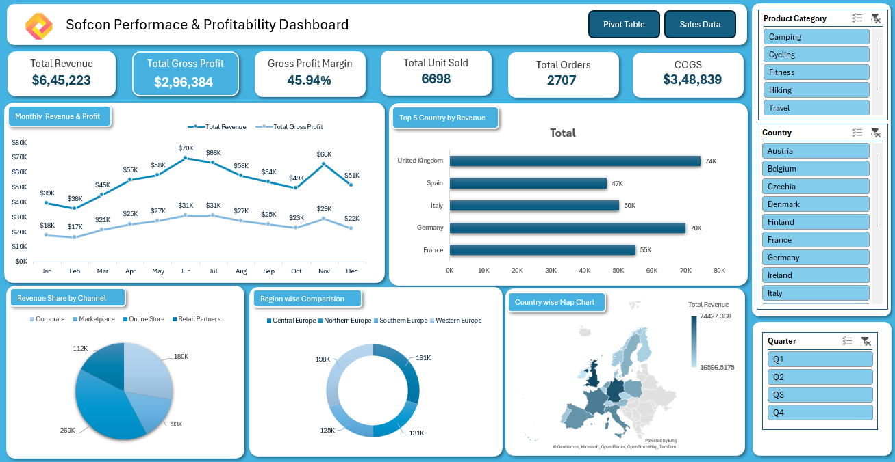

# 🌍 Global Sales Dashboard | Microsoft Excel

## 📊 Project Overview

This project presents an interactive **Global Sales Dashboard built in Microsoft Excel** to analyze sales performance, profitability, regional contributions, and monthly trends.

The dashboard transforms raw sales data into meaningful business insights using KPIs, PivotTables, PivotCharts, interactive slicers, and data visualization.

## 🎯 Project Objectives

- Analyze overall sales and profitability.
- Track monthly revenue and gross profit trends.
- Compare sales performance across countries and regions.
- Understand revenue contributions by sales channel.
- Enable interactive analysis using product category, country, and quarter filters.

## 📌 Key Performance Indicators (KPIs)

| KPI | Value |
|---|---:|
| Total Revenue | $645,223 |
| Total Gross Profit | $296,384 |
| Gross Profit Margin | 45.94% |
| Total Units Sold | 6,698 |
| Total Orders | 2,707 |
| Cost of Goods Sold (COGS) | $348,839 |

## 📈 Dashboard Features

- **Monthly Revenue & Profit:** Tracks monthly performance and identifies sales trends.
- **Top Countries by Revenue:** Compares revenue across leading countries.
- **Revenue Share by Channel:** Visualizes contributions from different sales channels.
- **Regional Comparison:** Compares sales across European regions.
- **Country-Wise Map:** Displays geographical revenue distribution.
- **Interactive Slicers:** Filters results by product category, country, and quarter.

## 🛠️ Tools & Skills

- Microsoft Excel
- PivotTables and PivotCharts
- KPI Design and Performance Tracking
- Data Cleaning and Analysis
- Data Visualization and Business Reporting
- Interactive Slicers and Filters
- Dashboard Design and Data Storytelling

## 💡 Business Insights

- The dashboard reports an overall gross profit margin of **45.94%**.
- Monthly comparisons help identify stronger and weaker revenue periods.
- Channel-wise analysis supports comparisons of revenue contributions.
- Country and regional analysis helps evaluate differences in market performance.
- Interactive filters allow users to explore results across different business segments.

## 📷 Dashboard Preview

## 🚀 How to Use

1. Download or clone this repository.
2. Open the Excel workbook in Microsoft Excel.
3. Navigate to the dashboard worksheet.
4. Use the slicers to filter by product category, country, and quarter.
5. Explore the KPIs and charts to understand sales performance.

## 📂 Project Files

- `Global_Sales_Dashboard.xlsx` — Interactive Excel dashboard.
- `dashboard.png` — Dashboard screenshot for preview.
- `README.md` — Project documentation.

*Update the filenames above to match the actual files you upload.*

## 📚 Key Learning Outcomes

This project helped strengthen my practical skills in Excel-based reporting, KPI development, sales analysis, and interactive dashboard design.

It also reinforced my ability to transform **raw data → meaningful insights → better business decisions.**

## 👤 About Me

I am building my skills in data analytics through hands-on projects focused on Excel, SQL, Python, Power BI, and business intelligence.

I enjoy using data to identify trends, understand business performance, and support data-driven decisions.

## 💬 Feedback

Have suggestions for improving this dashboard? Feel free to share your feedback or ideas for additional analysis.

⭐ If you find this project useful, consider giving this repository a star!

### 🔖 Tags

`Microsoft Excel` `Excel Dashboard` `Data Analytics` `Sales Analysis` `PivotTables` `Data Visualization` `Business Intelligence`
